# Lead Agent — local WhatsApp lead generation with a free, private AI

Finds local businesses, scores them with a local AI (Ollama), drafts a personal WhatsApp message for each, and
tracks replies and follow-ups in a phone-friendly dashboard. **Nothing is sent until you approve it.**
Everything runs on your own computer: no cloud AI, no paid API, your leads never leave your machine.
Connects to your CRM through a REST API and webhooks.

> ⚠️ By default this uses your normal WhatsApp number through an unofficial gateway (WAHA). Read
> [WhatsApp limits and ban risk](#whatsapp-limits-tos-and-ban-risk) first, or use the
> [official WhatsApp Cloud API](#official-whatsapp-cloud-api) instead.

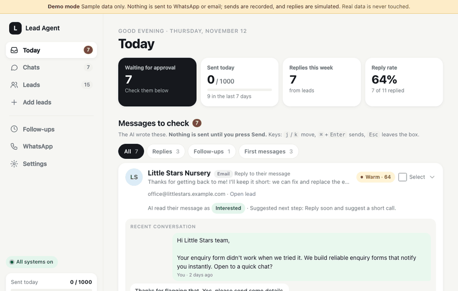

Try it without WhatsApp or Ollama: `./run.sh --demo` ([demo mode](#demo-mode)).


<details><summary>More screenshots: Leads and Settings</summary>

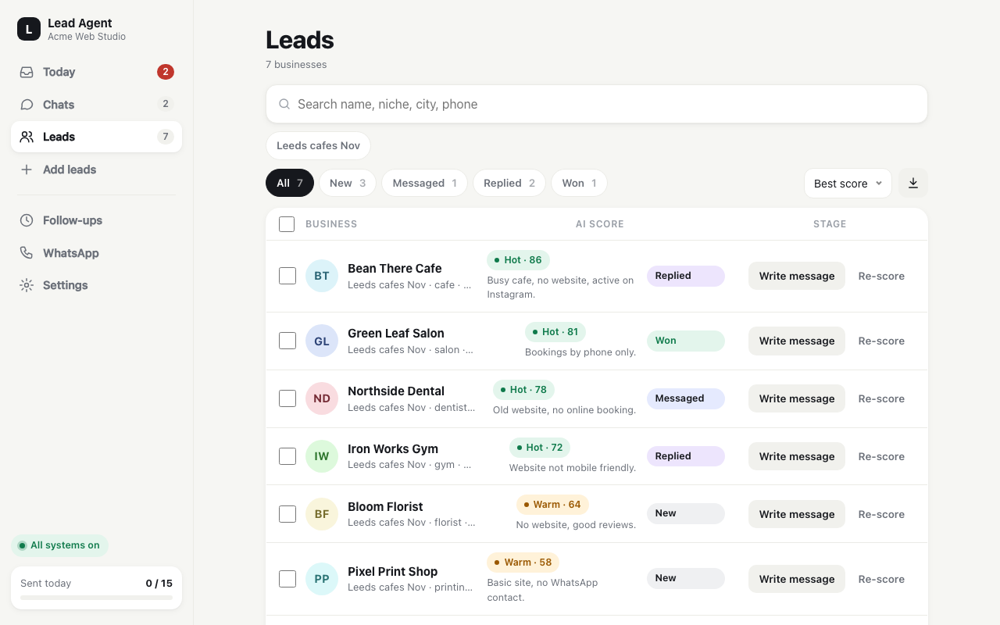

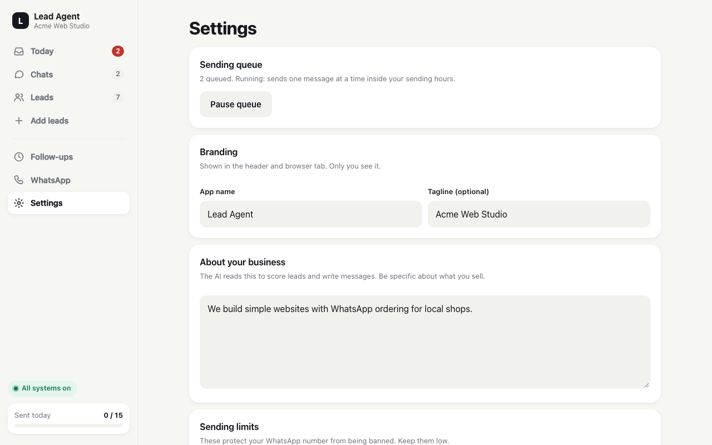
</details>

## Demo mode

See the whole app in a minute, with no WhatsApp, WAHA or Ollama:

```bash
./run.sh --demo          # or: DEMO_MODE=1 ./run.sh   or: python -m app.demo   (Windows: `.\run.ps1 --demo`)
```

Opens on http://127.0.0.1:8000 with ~15 sample leads across every stage, drafts waiting, sent messages, AI-tagged replies,
follow-ups and two campaigns. It has its own database (`demo.db`; it refuses to use `leads.db`), ignores your `.env` settings
for sending, and replaces WhatsApp and email with fakes that only record what "was sent". Open a lead and press
**Simulate reply** to pretend they wrote back: the reply goes through the real pipeline (AI tag, reply draft, follow-ups
cancelled, STOP opts out). If Ollama is running it writes the drafts, otherwise canned drafts are used. A "Demo mode"
banner is shown on every page. Delete `demo.db` to start over.

## Features

- **Find leads**: OpenStreetMap search (niche + city), [Google Places](#google-places-optional-lead-source) (optional key, much better
  coverage in many countries), CSV import, or by hand. Duplicates (phone, website, name+city) merge.
- **AI score (0-100)** and a draft first message per lead, written from your business description. Edit, approve, send;
  or tick several and "Send selected". Quick rewrites: shorter, more formal, Roman Urdu.
- **Replies**: incoming WhatsApp messages land in Chats with an AI tag (interested, asking price, not now, not
  interested) and a suggested next step. Unknown numbers that write to you become leads.
- **Follow-ups** after 3 and 7 days (editable); a reply cancels them.
- **[Sending queue](#sending-queue)**: approved messages go out one at a time in the background, with random gaps,
  only inside your sending hours; the rest wait for the next window. Pause/Resume in Settings.
- **Safety**: approval before every send, daily limit, per-weekday sending hours, STOP/opt-out respected everywhere,
  opt-out line on first messages, optional dashboard password.
- **Two WhatsApp options**: WAHA (free, your own number, unofficial) or the
  [official WhatsApp Cloud API](#official-whatsapp-cloud-api) (Meta business number, approved templates).
- **[CRM integration](#crm-integration)**: REST API (`/api/v1`, API key) and signed outgoing webhooks for HubSpot,
  Zoho, Pipedrive, Salesforce, Odoo, n8n, Zapier or Make. Details: [docs/INTEGRATIONS.md](docs/INTEGRATIONS.md).
- **[Email channel](#email-channel)** (optional): leads that have an email but no WhatsApp get email drafts (subject + plain text),
  sent through the same queue with their own daily limit; replies are read over IMAP and handled like WhatsApp replies.
- Lead page with chat, notes and reminders, campaign tags, "find email/phone on website", CSV export, reply-rate stats.
- Daily backup of `leads.db` to `backups/` (last 14). Optional phone push on replies via [ntfy](https://ntfy.sh).

## How it compares

There are other good open-source outreach tools. This is how Lead Agent differs, based on each project's public README
(November 2026; corrections welcome).

| Tool | Channels | AI | Lead source | Notes |
|---|---|---|---|---|
| **Lead Agent** | WhatsApp (WAHA or official Cloud API) | Local (Ollama), free | OpenStreetMap, Google Places API, CSV | Approval before every send, sending queue, reply tags, follow-ups, REST API + webhooks, SQLite |
| [Prospex](https://github.com/asiifdev/business-leads-ai-automation) | WhatsApp (Baileys) | Drafts and scoring | Google Maps scraping | Approval, caps, quiet hours, random gaps; self-host or hosted |
| [AgentSDR](https://github.com/Kandid-ai/AgentSDR) | Email, LinkedIn, WhatsApp (via Unipile) | Your own AI key | Enrichment tables | Full AI CRM with reply drafts; needs PostgreSQL |
| [openoutbound](https://github.com/xyluxx/openoutbound) | Email, LinkedIn | Cloud or Ollama | Buying signals | AI SDR engine with MCP, CLI and REST API |
| [OpenOutreach](https://github.com/eracle/OpenOutreach) | Email | Cloud AI | Finds people for your product | B2B, sends from your mailbox |
| [Google Maps scrapers](https://github.com/topics/google-maps-scraper) | None | None | Google Maps | Export a CSV; no messages or replies |

**Pick Lead Agent if** you sell to local businesses that answer WhatsApp more than email, want the AI and your data to
stay on your own machine at no cost, and want the whole loop in one small app: find, write, approve, send, handle
replies, follow up, and sync to your CRM. **Look elsewhere if** you mainly need email or LinkedIn sequences, a team CRM,
or large-volume sending.

## Setup (about 15 minutes)

You need a computer that stays on while you use it (Mac, Linux or Windows 10/11, 8 GB RAM) and a phone with
WhatsApp. A separate business number is best.

### 1. Install three free tools

| Tool | What it's for | macOS | Windows | Linux |
|---|---|---|---|---|
| **Python 3.11+** | runs the dashboard | [python.org](https://www.python.org/downloads/) | [python.org](https://www.python.org/downloads/) (tick **Add to PATH**) | usually installed |
| **Ollama** | the local AI | [ollama.com/download](https://ollama.com/download) | [ollama.com/download](https://ollama.com/download) | `curl -fsSL https://ollama.com/install.sh \| sh` |
| **Docker** | the WhatsApp gateway | [Docker Desktop](https://www.docker.com/products/docker-desktop/) | [Docker Desktop](https://www.docker.com/products/docker-desktop/) | [Docker Engine](https://docs.docker.com/engine/install/) |

Open Ollama and Docker once so they are running. (Mac alternative to Docker Desktop:
`brew install colima docker docker-compose && colima start`.)

### 2. Download and run the setup

[Download the ZIP](https://github.com/MHamzaShahzad/lead-agent/archive/refs/heads/main.zip) and unzip it, or `git clone` this repo. Open a terminal
in the folder (Windows: right-click the folder → *Open in Terminal*) and run:

```bash
python3 setup.py
```
Windows: `py setup.py`

It asks what you sell, a name for the dashboard and your country code, then does the rest: creates `.env` with
random passwords, installs everything, downloads the AI model (~2 GB) and starts the WhatsApp gateway.
**It prints your dashboard password at the end - save it.** Safe to run again if something failed.

### 3. Start the dashboard

On first run the dashboard opens a guided **setup page** (`/setup`: password, business, WhatsApp, API keys, sending hours); you can reopen it from Settings.


```bash
./run.sh
```
Windows: `powershell -ExecutionPolicy Bypass -File .\run.ps1`

Open http://localhost:8000 and sign in. Keep the terminal open while you use it (Ctrl+C stops it).

### 4. Link your WhatsApp

(Details: [Setup guides](#setup-guides).) In the dashboard: **More → WhatsApp**, type your number with country code and press **Get pairing code**.
On your phone: WhatsApp → Settings → **Linked devices** → **Link a device** → *Link with phone number instead*,
and type the 8-character code.

That's it. Go to **Add leads**, search e.g. "dentist" in your city, check the AI's messages in **Today** and press
Send on the ones you like.

<details><summary>Manual setup (without setup.py)</summary>

1. `cp .env.example .env` (Windows: `copy .env.example .env`) and edit it: set `DASHBOARD_PASSWORD`, `WAHA_API_KEY`
   and `WEBHOOK_TOKEN` to long random values (`python3 -c "import secrets;print(secrets.token_urlsafe(24))"`),
   `MY_BUSINESS`, `DEFAULT_COUNTRY_CODE`, and `WAHA_IMAGE`: `devlikeapro/waha:gows` (Intel/AMD) or
   `devlikeapro/waha:gows-arm` (Apple Silicon / ARM).
2. `ollama pull llama3.2:3b`
3. `docker compose --env-file .env up -d`
4. `./run.sh` (creates `.venv` and installs requirements the first time).
5. Link WhatsApp as in step 4, or scan the QR code in the WAHA dashboard at http://localhost:3000/dashboard
   (user `admin`, password = `WAHA_API_KEY`).
</details>

**Every day after:** make sure Ollama and Docker are running, then `./run.sh`. After changing `.env` by hand,
restart the dashboard (Ctrl+C, then `./run.sh`).

## Setup guides

Step-by-step help for each connection. Only Ollama and one WhatsApp provider are required. Screenshots show the dashboard in
[demo mode](#demo-mode) (sample data only). Third-party consoles (Meta, Google, Gmail, n8n) change often, so those steps link to
the official docs instead of screenshots. Open a block to read it.

<details><summary><b>Ollama</b> (the local AI)</summary>

1. Install from [ollama.com/download](https://ollama.com/download) and open it once (it runs in the background).
2. Download the model: `ollama pull llama3.2:3b` (about 2 GB). `setup.py` does this for you.
3. Check it: `curl http://localhost:11434/api/tags` lists the model, and the dashboard header shows the AI as ready.
4. Other model or machine: set `OLLAMA_MODEL` / `OLLAMA_URL` in `.env` (or the AI model field in **Settings**) and restart.
5. Dashboard in Docker: set `DOCKER_OLLAMA_URL=http://host.docker.internal:11434`; on Linux start Ollama with `OLLAMA_HOST=0.0.0.0`.

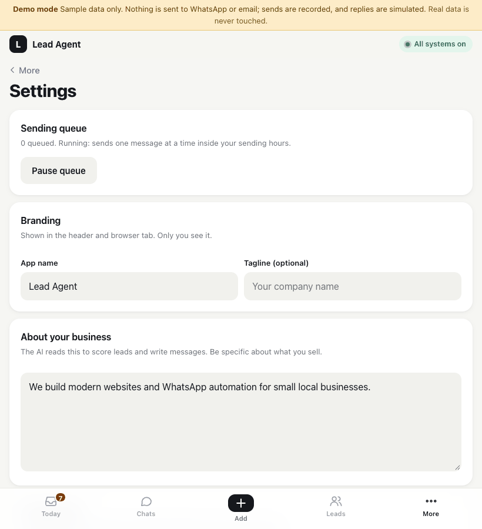
</details>

<details><summary><b>WAHA</b> (link your WhatsApp)</summary>

WAHA runs in Docker and links your phone as a "linked device". Read the [ban-risk section](#whatsapp-limits-tos-and-ban-risk) first.

1. `setup.py` (step 2 above) starts it. By hand: set `WAHA_API_KEY`, `WEBHOOK_TOKEN` and `WAHA_IMAGE` in `.env`
   (`devlikeapro/waha:gows`, or `gows-arm` on Apple Silicon), then `docker compose --env-file .env up -d`.
2. On `/setup` step 3 choose **WAHA** and press **Test connection** (it only reads status, never sends).
3. Open **More → WhatsApp**, type your number with country code, press **Get pairing code**.
4. On the phone: WhatsApp → Settings → **Linked devices** → **Link a device** → *Link with phone number instead* → type the 8-character code.
   (QR alternative: http://localhost:3000/dashboard, user `admin`, password = `WAHA_API_KEY`.)
5. The card turns to **Connected**. If it logs out later, repeat step 3. Optional hardening: `WAHA_WEBHOOK_HMAC_KEY`.

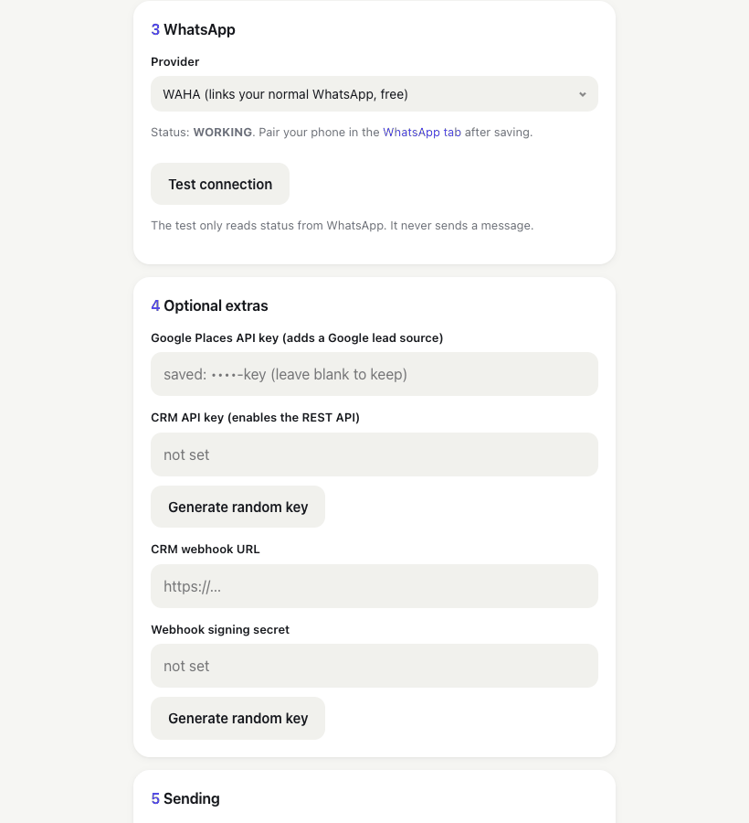
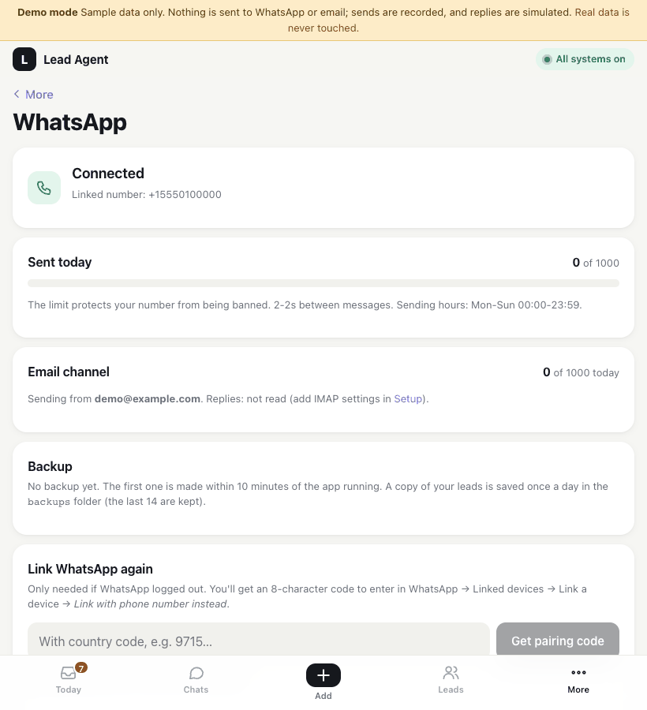
</details>

<details><summary><b>WhatsApp Cloud API</b> (official, ToS-compliant)</summary>

Needs a free Meta developer account and a business phone number. Follow Meta's own
[Cloud API get started](https://developers.facebook.com/docs/whatsapp/cloud-api/get-started) guide alongside:

1. At [developers.facebook.com/apps](https://developers.facebook.com/apps) create a **Business** app and add the **WhatsApp** product.
2. WhatsApp → API setup: add your business phone number and note the **Phone number ID**.
3. Make a permanent token: Business settings → Users → **System users** → add one → *Generate token* with `whatsapp_business_messaging`
   and `whatsapp_business_management` ([how](https://developers.facebook.com/docs/whatsapp/business-management-api/get-started)).
4. App settings → Basic: copy the **App secret**.
5. On `/setup` step 3 choose **Official Cloud API**, paste token, phone number ID and app secret, and press **Generate random key** for the verify token. Save
   (or set `WHATSAPP_PROVIDER=cloud`, `WA_CLOUD_TOKEN`, `WA_CLOUD_PHONE_NUMBER_ID`, `WA_CLOUD_APP_SECRET`, `WA_CLOUD_VERIFY_TOKEN` in `.env`).
6. Meta → WhatsApp → Configuration → Webhook: callback `https://YOUR-PUBLIC-URL/webhook/cloud` (shown on the setup page), your verify token, subscribe to **messages**.
   It must be reachable from the internet (see Remote access below). It skips the dashboard login but rejects requests without a valid `X-Hub-Signature-256`.
7. **24-hour rule:** free text only goes to leads who wrote in the last 24 hours. For first contact create a template in
   [WhatsApp Manager](https://business.facebook.com/wa/manage/message-templates/) (category *Marketing*, one body variable, e.g. `Hi! {{1}}`),
   wait for approval, then set `WA_CLOUD_TEMPLATE` (+ `WA_CLOUD_TEMPLATE_LANG`). The draft text goes into `{{1}}`. Without a template, drafts to new leads are blocked and the card says why.
8. **Costs:** Meta charges per delivered template message (cents each, varies by country; see [Meta pricing](https://developers.facebook.com/docs/whatsapp/pricing)). Replies inside the window are free.

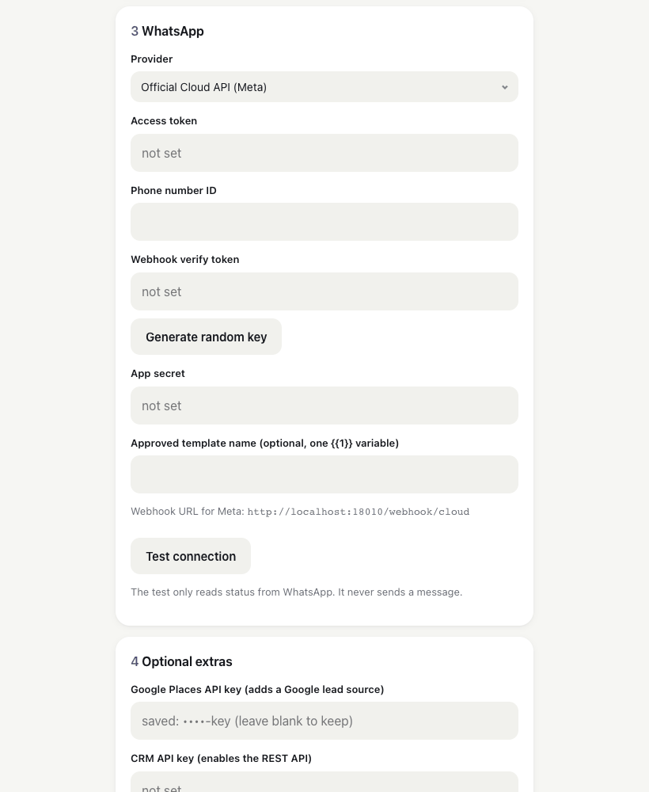
</details>

<details><summary><b>Google Places</b> (extra lead source)</summary>

1. In the [Google Cloud console](https://console.cloud.google.com/) create or pick a project and
   [enable billing](https://cloud.google.com/billing/docs/how-to/modify-project) (required; the free monthly credit covers small use).
2. Enable **Places API (New)** in the [API library](https://console.cloud.google.com/apis/library/places.googleapis.com).
3. APIs & Services → Credentials → **Create credentials → API key** ([guide](https://developers.google.com/maps/documentation/places/web-service/get-api-key)).
4. Restrict the key to *Places API (New)* only and set a daily quota cap ([pricing](https://developers.google.com/maps/billing-and-pricing/pricing)).
5. Paste it on `/setup` step 4 (or `GOOGLE_PLACES_API_KEY` in `.env`, then restart). **Add leads** now has a *Source* choice: OpenStreetMap or Google Places.

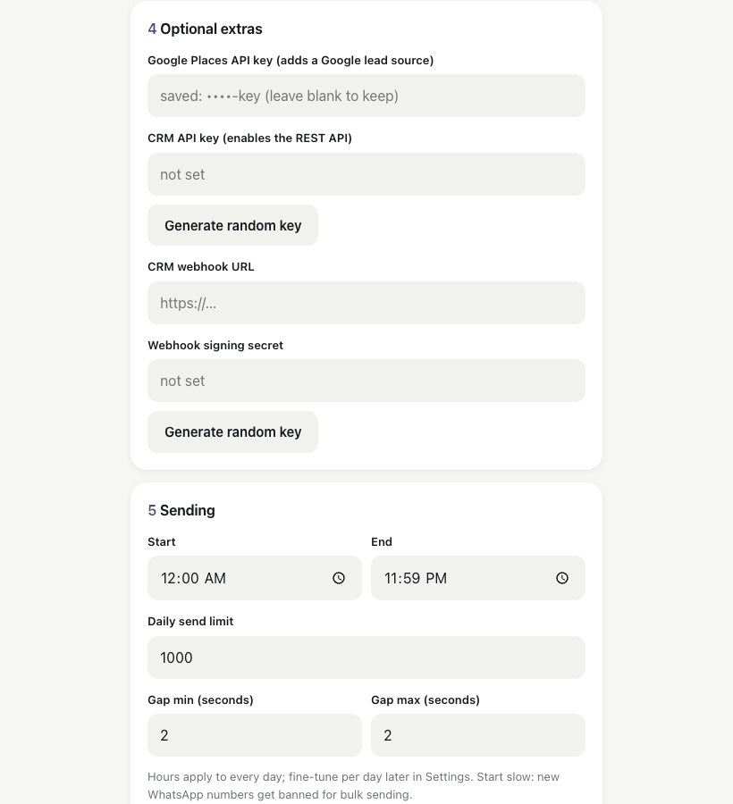
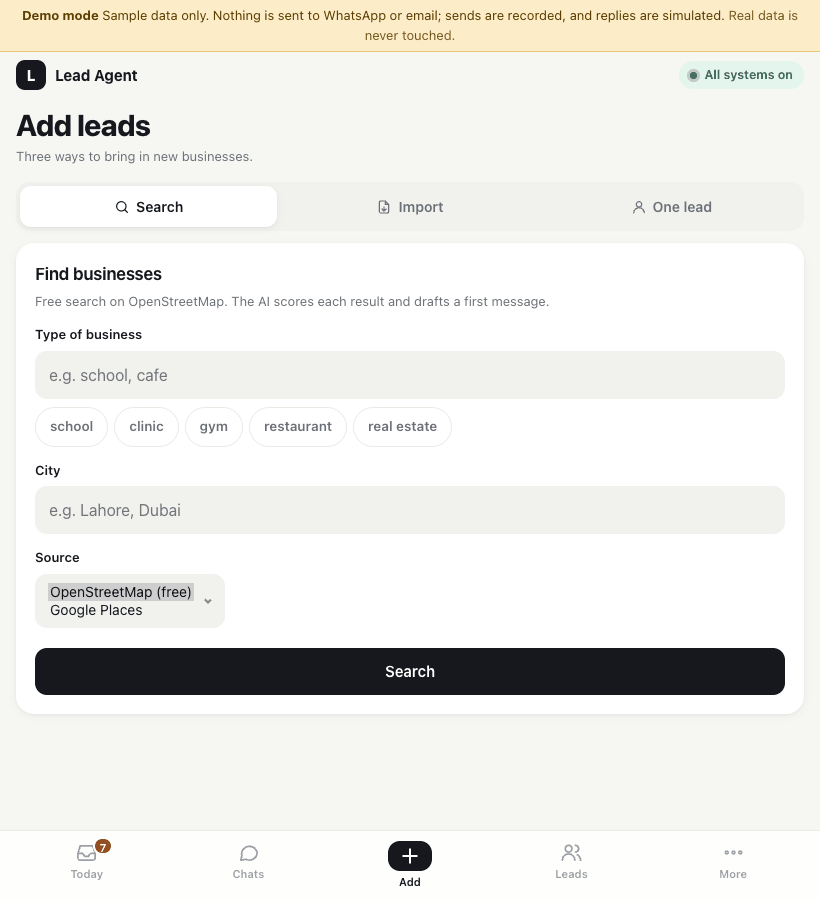
</details>

<details><summary><b>Email</b> (SMTP sending, IMAP replies, Gmail app password)</summary>

1. Use a dedicated mailbox. **Gmail:** turn on 2-Step Verification, then create an [app password](https://support.google.com/accounts/answer/185833)
   (Google Account → Security → App passwords). Use that 16-character password, not your normal one. Workspace admins may need to allow it.
2. `/setup` step 6 (or `.env`): SMTP host `smtp.gmail.com`, port `587`, STARTTLS, your address as user, the app password, and the From address.
   Other providers: use the host and port from their docs (often 587 STARTTLS or 465 SSL).
3. Optional replies: IMAP host `imap.gmail.com` (port 993, SSL; user and password default to the SMTP ones). Enable IMAP in Gmail → Settings → Forwarding and POP/IMAP.
4. Press **Test email login** (it only logs in, never sends), then save.
5. A lead with an email and no phone now gets an email draft with subject and body. Approve it like any draft; it uses the same queue.
6. Start with a low `EMAIL_DAILY_LIMIT`, set SPF/DKIM/DMARC for your domain and check the cold-email law where you and your leads live.

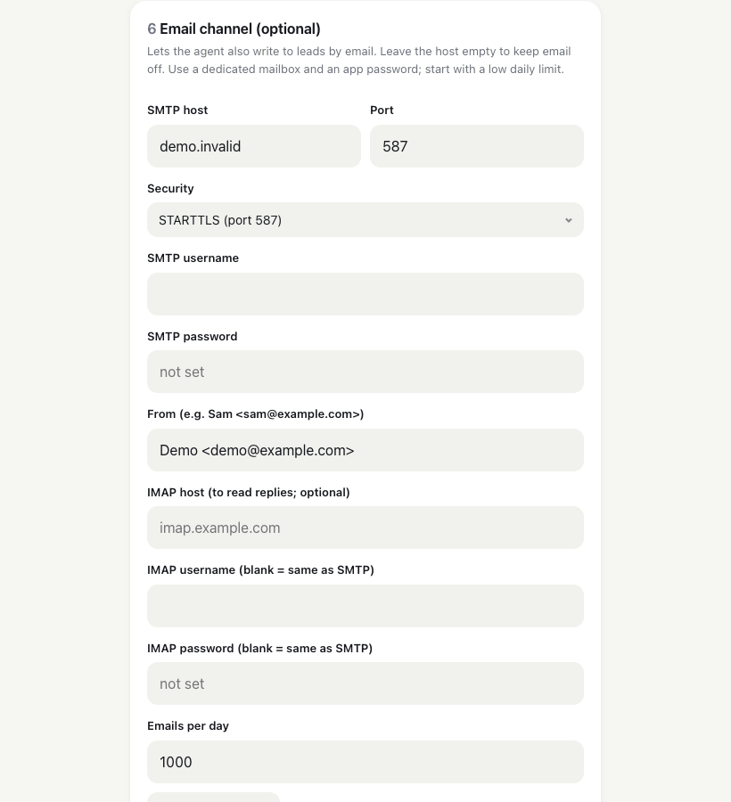
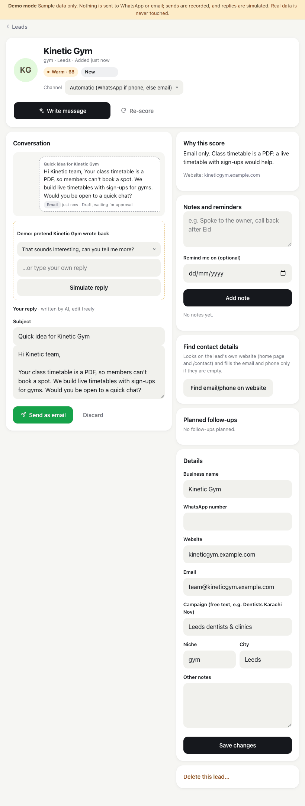
</details>

<details><summary><b>CRM</b> (API key, webhooks, n8n example)</summary>

1. `/setup` step 4: press **Generate random key** under *CRM API key* and under *Webhook signing secret* (or set `API_KEY` / `CRM_WEBHOOK_SECRET` in `.env`). Save both somewhere safe.
2. Test the API: `curl -H "Authorization: Bearer YOUR_API_KEY" http://localhost:8000/api/v1/leads` returns JSON.
3. **n8n, Lead Agent to CRM:** in [n8n](https://docs.n8n.io/) add a **Webhook** node (POST), copy its *Production URL* into *CRM webhook URL* (`CRM_WEBHOOK_URL`) and activate the workflow.
   Add a **Switch** on `{{$json.body.event}}` (`lead.created`, `reply.received`, `lead.stage_changed`) leading to your CRM node
   ([HubSpot](https://docs.n8n.io/integrations/builtin/app-nodes/n8n-nodes-base.hubspot/), Pipedrive, Zoho, ...).
4. **n8n, CRM to Lead Agent:** CRM trigger → **HTTP Request** node: `POST http://localhost:8000/api/v1/leads`, header `Authorization: Bearer YOUR_API_KEY`,
   JSON body with `name`, `email` or `phone`, and `external_id` = the CRM record id. n8n in Docker: use `host.docker.internal` instead of `localhost`.
5. Signature checks, all payloads and Zapier/Make recipes: [docs/INTEGRATIONS.md](docs/INTEGRATIONS.md). Drafts still need your approval; the API cannot send.


</details>

<details><summary><b>ntfy</b> (push to your phone on replies)</summary>

1. Install the free **ntfy** app ([iOS](https://apps.apple.com/app/ntfy/id1625396347) / [Android](https://play.google.com/store/apps/details?id=io.heckel.ntfy)) or use [ntfy.sh](https://ntfy.sh).
2. Pick a long random topic: `python3 -c "import secrets;print('lead-'+secrets.token_urlsafe(16))"`. The topic name is the only secret, so keep it unguessable.
3. In the app: **+** → subscribe to that topic on the default server.
4. Put `NTFY_TOPIC=<topic>` in `.env` and restart. You get "New reply from <name>" (never the message text).
</details>

<details><summary><b>Docker Compose</b> (everything in containers)</summary>

Alternative to `setup.py` + `./run.sh`: only Docker is needed.

```bash
cp .env.example .env     # set the three passwords; Apple Silicon: WAHA_IMAGE=devlikeapro/waha:gows-arm
docker compose -f docker-compose.full.yml up -d --build
```
Open http://localhost:8000. Dashboard, WAHA and your data (volumes `data`, `waha_sessions`) all live in Docker.

- **Ollama on your computer (default):** install it, `ollama pull llama3.2:3b`, add `DOCKER_OLLAMA_URL=http://host.docker.internal:11434` to `.env` (Linux: `OLLAMA_HOST=0.0.0.0`).
- **Ollama in Docker (CPU only, slower on Mac):** add `--profile ollama`, then once:
  `docker compose -f docker-compose.full.yml --profile ollama run --rm ollama-pull`.
- Ports: `DASHBOARD_PORT`, `WAHA_PORT`; `DASHBOARD_BIND=0.0.0.0` exposes it on your network (set a dashboard password first).
- Backups are in the `data` volume: `docker compose -f docker-compose.full.yml cp dashboard:/data/backups ./backups-copy`.
- Apple Silicon: use the `gows-arm` image and give Docker/Colima about 4 GB RAM.
- The plain `docker-compose.yml` (WAHA only) is what `setup.py` uses; do not run both on the same ports.
</details>

<details><summary><b>Remote access</b> (use it from your iPhone)</summary>

1. Install [Tailscale](https://tailscale.com/download) on the Mac and the iPhone and sign in to the **same account** on both.
2. On the Mac: `HOST=127.0.0.1 ./run.sh`, then `tailscale serve --bg 8000`.
3. Open the `https://your-mac.your-tailnet.ts.net` link it prints on the iPhone, then *Add to Home Screen*.
4. Keep `DASHBOARD_PASSWORD` set. **Never** port-forward 8000 or use `tailscale funnel` for the dashboard.

Full guide and safety rules: [docs/REMOTE_ACCESS.md](docs/REMOTE_ACCESS.md).
</details>

## Run with Docker

Only Docker needed: `docker compose -f docker-compose.full.yml up -d --build`. Steps: [Setup guides → Docker Compose](#setup-guides).

## Sending queue

Pressing Send (or Send selected) only *queues* a message. One background worker sends queued messages one at a time,
only inside your sending hours and under the daily limit; otherwise they wait for the next window (the queue survives restarts).
Each gap is random between `SEND_GAP_MIN` and `SEND_GAP_MAX` seconds (unset = the fixed `MIN_SECONDS_BETWEEN_SENDS`), with a short
"typing..." first (`SEND_TYPING=0` to disable). Queued items show "sends at ~HH:MM" and a Cancel button (back to draft); the Overview
lists the queue and Settings has Pause/Resume. A message is skipped if the lead opts out or replies while it waits; failed sends keep
their error and "Try again".

## Email channel

Off until you set `SMTP_HOST` and `SMTP_FROM` (on `/setup` step 6 or in `.env`; Gmail app-password steps in [Setup guides](#setup-guides)). Then:

- **Per lead**: WhatsApp if the lead has a phone, otherwise email. Change it on the lead page (Channel), or press "Switch to Email/WhatsApp" on a draft.
  Replies are answered on the channel the lead wrote on; follow-ups use the channel of your last message.
- **Drafts**: the AI writes a subject and a plain-text body from your business description. You edit both and approve, as for WhatsApp.
- **Sending**: the same queue, sending hours, gaps and approval. Emails have their own `EMAIL_DAILY_LIMIT` (default 30), separate from
  `DAILY_SEND_LIMIT`. Use a dedicated mailbox and an app password, and start low: cold email can hurt your domain's reputation.
  Check SPF/DKIM/DMARC for your sending domain and the cold-email law where you and your leads live (CAN-SPAM, GDPR/PECR, CASL).
- **Unsubscribe**: the first email to a lead ends with an unsubscribe line, and every email carries a `List-Unsubscribe` (mailto) header.
  "unsubscribe", "remove me" and similar replies mark the lead opted out and cancel follow-ups, same as STOP.
- **Replies** (optional `IMAP_HOST`, IMAP over SSL; `IMAP_USER`/`IMAP_PASSWORD` default to the SMTP ones): checked every 3 minutes, only when
  configured. A reply is matched by `In-Reply-To`/`References` or by the sender's address; mail from unknown senders, bounces and
  auto-replies is ignored. It gets the same AI tag, follow-up cancel, push alert and CRM `reply.received` webhook (with `channel: email`).
  Handled mail is only flagged read; nothing is ever deleted. The first check just remembers where the mailbox ends, so old mail is not imported.
- **Status**: the WhatsApp tab shows an Email card (sent today, last inbox check, errors). "Test email login" on `/setup` only logs in.
- Webhook `message.sent` also carries `channel` (and `subject` for email).

## Configuration

Most settings are in the dashboard's **Settings** tab and are saved to `.env`: app name and tagline, business
description, daily limit, seconds between messages (min/max), follow-up days, per-weekday sending hours, opt-out line, AI model.
Only in `.env`: `DASHBOARD_PASSWORD`, `WAHA_API_KEY`, `WEBHOOK_TOKEN`, `WAHA_WEBHOOK_HMAC_KEY`, `DEFAULT_COUNTRY_CODE`, `WAHA_IMAGE`,
`OLLAMA_URL`, `WAHA_URL`, `NTFY_TOPIC`, `GOOGLE_PLACES_API_KEY`, `API_KEY`, `CRM_WEBHOOK_URL`, `CRM_WEBHOOK_SECRET`,
`WHATSAPP_PROVIDER` and the `WA_CLOUD_*` keys, `SEND_TYPING`, and the email keys `SMTP_*`, `IMAP_*`, `EMAIL_DAILY_LIMIT`. Every option is described in [.env.example](.env.example).

## CRM integration

Plug it into HubSpot, Zoho, Pipedrive, Salesforce, Odoo or anything else with a REST API (`API_KEY`, `/api/v1`) and
outgoing signed webhooks (`CRM_WEBHOOK_URL`, `CRM_WEBHOOK_SECRET`), directly or via n8n, Zapier or Make. The API
cannot send WhatsApp messages; drafts still need your approval. Details, event payloads, signature checks and recipes:
[docs/INTEGRATIONS.md](docs/INTEGRATIONS.md). Key and n8n steps: [Setup guides → CRM](#setup-guides).

## Google Places (optional lead source)

Set `GOOGLE_PLACES_API_KEY` and the Find form gets a Google source (official Text Search API, no scraping, up to 60 results; Google bills
per request, its free monthly credit covers small use). Key steps: [Setup guides → Google Places](#setup-guides).

Using it from your phone: [docs/REMOTE_ACCESS.md](docs/REMOTE_ACCESS.md) (Tailscale; never expose port 8000 to the internet).

## Official WhatsApp Cloud API

WAHA links a normal account (ban risk). For a ToS-compliant setup set `WHATSAPP_PROVIDER=cloud`; limits, AI tags, follow-ups and
STOP handling work the same. Free text only inside 24 hours of the lead's last message; first contact needs an approved template.
Steps, webhook and costs: [Setup guides → WhatsApp Cloud API](#setup-guides).

## WhatsApp limits, ToS and ban risk

- WAHA connects your **normal WhatsApp account** as a linked device. This is **not** the official API and is against
  WhatsApp's Terms of Service for automated or bulk messaging. Your number can be **banned**, temporarily or forever.
  You use this at your own risk; the authors accept no liability.
- Only message businesses that plausibly want to hear from you, follow your local anti-spam and privacy laws
  (e.g. GDPR, PECR, TCPA), and stop when someone says STOP (the app does this automatically).
- Start with 10-15 messages a day on a new number, keep the gap between messages, personalise every message,
  avoid links in first messages, and prefer a separate number.
- For volume or marketing use the official [WhatsApp Cloud API](https://developers.facebook.com/docs/whatsapp/cloud-api)
  (first messages must be approved templates).

## Privacy and security

- **Data stays local**: leads and chats are in `leads.db`, WhatsApp session keys in `waha_sessions/`, settings and
  secrets in `.env`. All three are git-ignored; back them up privately and never commit or share them.
- The AI runs locally in Ollama. The only outside calls are OpenStreetMap (lead search), the websites you ask it to
  scan for contacts, WhatsApp itself, and ntfy if you turn it on (it gets "New reply from <name>" only).
- **Set `DASHBOARD_PASSWORD`.** The dashboard listens on your network (`0.0.0.0`) so the Docker container can reach the
  webhook; use `HOST=127.0.0.1 ./run.sh` if your Docker setup allows it. Never port-forward 8000 or 3000 to the internet;
  use Tailscale or a VPN for remote access.
- `/webhook/waha` must stay reachable without the dashboard login, so protect it with `WEBHOOK_TOKEN`
  (docker-compose.yml passes it to WAHA). WAHA's port 3000 is bound to localhost only.
- **Signed webhooks (optional)**: set `WAHA_WEBHOOK_HMAC_KEY` in `.env` (`setup.py` generates one). The compose files pass
  it to WAHA as `WHATSAPP_HOOK_HMAC_KEY`; WAHA then signs each webhook body (HMAC-SHA512, `X-Webhook-Hmac` header) and
  `/webhook/waha` rejects a missing or wrong signature (constant-time compare). It works alongside `WEBHOOK_TOKEN`; both
  must pass when both are set. Recreate the `waha` container after changing the key. Unset = no signature check.
- Secrets are never written to logs or shown in the dashboard.

## Troubleshooting

- **WAHA dashboard says "not connected" / 401**: it caches the API key in the browser. After changing `WAHA_API_KEY`,
  recreate the container (`docker compose --env-file .env up -d --force-recreate`), log in again and re-enter the key
  in the WAHA dashboard's server settings, or clear site data for localhost:3000.
- **Replies don't arrive**: check `docker logs waha` for webhook errors; the dashboard must run on port 8000 and
  `WEBHOOK_TOKEN` must match in `.env` for both (recreate the container after changing it). On Linux without Docker
  Desktop, `host.docker.internal` comes from `extra_hosts` in docker-compose.yml.
- **"Add the country code"** when sending: the number starts with 0; set `DEFAULT_COUNTRY_CODE` or edit the number.
- **Drafts say `[fallback]`**: Ollama was not reachable. Run `ollama list`, check `OLLAMA_URL` and the model name.
- **Apple Silicon: container exits / exec format error**: set `WAHA_IMAGE=devlikeapro/waha:gows-arm`.
- **Pairing code doesn't work**: codes expire within minutes; press Link again. Make sure the number has the country code.

## Development and tests

See [CONTRIBUTING.md](CONTRIBUTING.md) and the [CHANGELOG](CHANGELOG.md). `./run.sh --demo` is the quickest way to try UI changes.

```bash
.venv/bin/python -m pytest -q                 # no Ollama or WhatsApp needed (fallbacks + fake sender)
REAL_OLLAMA=1 .venv/bin/python -m pytest -q   # with the real local AI
```
Windows: `.\.venv\Scripts\python.exe -m pytest -q`. CI runs the tests on every push (`.github/workflows/tests.yml`).

**Code map**: `app/main.py` (routes, webhooks, background loop), `app/ui.py` (HTML/CSS/JS, server-rendered, no build
step), `app/db.py` (SQLite), `app/ai.py` (Ollama prompts, reply tags), `app/whatsapp.py` (WAHA, limits, sending hours),
`app/wa_cloud.py` (official Cloud API), `app/sendqueue.py` (sending queue worker), `app/api.py` (`/api/v1` REST API),
`app/webhooks.py` (signed CRM webhooks), `app/finder.py` (OSM, Google Places, CSV, website contacts),
`app/notify.py` (ntfy), `app/auth.py`, `app/config.py`.
Build notes: [docs/HISTORY.md](docs/HISTORY.md). Contributions: [CONTRIBUTING.md](CONTRIBUTING.md).

## License

MIT — see [LICENSE](LICENSE).
