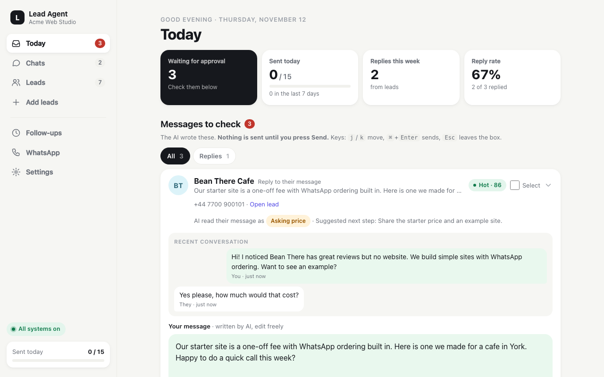
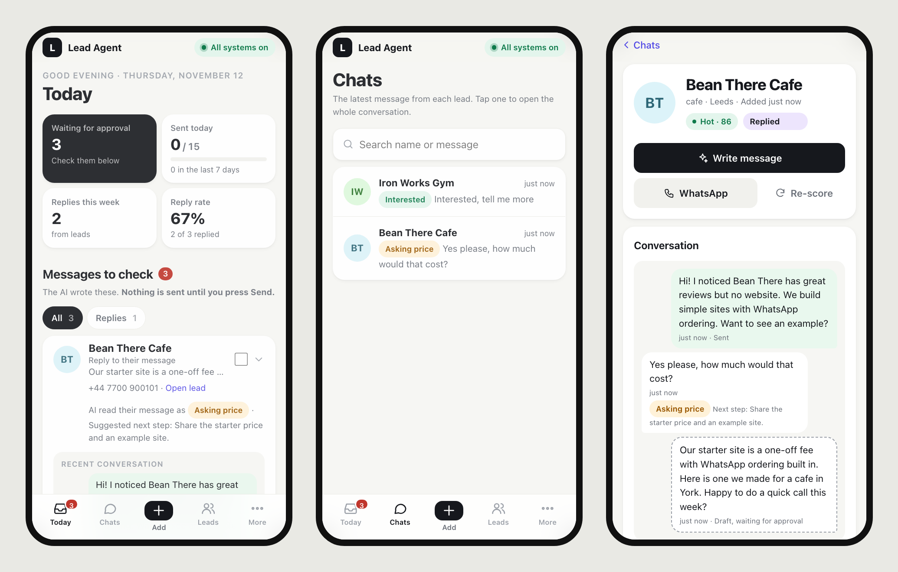

# Lead Agent — local WhatsApp lead generation with a free, private AI

Finds local businesses, scores them with a local AI (Ollama), drafts a personal WhatsApp message for each, and
tracks replies and follow-ups in a phone-friendly dashboard. **Nothing is sent until you approve it.**
Everything runs on your own computer: no cloud AI, no paid API, your leads never leave your machine.

> ⚠️ This uses your normal WhatsApp number through an unofficial gateway. Read [WhatsApp limits and ban risk](#whatsapp-limits-tos-and-ban-risk) first.





## Features

- **Find leads**: OpenStreetMap search (niche + city), CSV import, or by hand. Duplicates (phone, website, name+city) merge.
- **AI score (0-100)** and a draft first message per lead, written from your business description. Edit, approve, send;
  or tick several and "Send selected". Quick rewrites: shorter, more formal, Roman Urdu.
- **Replies**: incoming WhatsApp messages land in Chats with an AI tag (interested, asking price, not now, not
  interested) and a suggested next step. Unknown numbers that write to you become leads.
- **Follow-ups** after 3 and 7 days (editable); a reply cancels them.
- **Safety**: approval before every send, daily limit, gap between messages, per-weekday sending hours, STOP/opt-out
  respected everywhere, opt-out line on first messages, optional dashboard password.
- Lead page with chat, notes and reminders, campaign tags, "find email/phone on website", CSV export, reply-rate stats.
- Daily backup of `leads.db` to `backups/` (last 14). Optional phone push on replies via [ntfy](https://ntfy.sh).

## Setup (about 15 minutes)

You need a computer that stays on while you use it (Mac, Linux or Windows 10/11, 8 GB RAM) and a phone with
WhatsApp. A separate business number is best.

### 1. Install three free tools

| Tool | What it's for | macOS | Windows | Linux |
|---|---|---|---|---|
| **Python 3.11+** | runs the dashboard | [python.org](https://www.python.org/downloads/) | [python.org](https://www.python.org/downloads/) (tick **Add to PATH**) | usually installed |
| **Ollama** | the local AI | [ollama.com/download](https://ollama.com/download) | [ollama.com/download](https://ollama.com/download) | `curl -fsSL https://ollama.com/install.sh \| sh` |
| **Docker** | the WhatsApp gateway | [Docker Desktop](https://www.docker.com/products/docker-desktop/) | [Docker Desktop](https://www.docker.com/products/docker-desktop/) | [Docker Engine](https://docs.docker.com/engine/install/) |

Open Ollama and Docker once so they are running. (Mac alternative to Docker Desktop:
`brew install colima docker docker-compose && colima start`.)

### 2. Download and run the setup

[Download the ZIP](https://github.com/MHamzaShahzad/lead-agent/archive/refs/heads/main.zip) and unzip it, or `git clone` this repo. Open a terminal
in the folder (Windows: right-click the folder → *Open in Terminal*) and run:

```bash
python3 setup.py
```
Windows: `py setup.py`

It asks what you sell, a name for the dashboard and your country code, then does the rest: creates `.env` with
random passwords, installs everything, downloads the AI model (~2 GB) and starts the WhatsApp gateway.
**It prints your dashboard password at the end - save it.** Safe to run again if something failed.

### 3. Start the dashboard

```bash
./run.sh
```
Windows: `powershell -ExecutionPolicy Bypass -File .\run.ps1`

Open http://localhost:8000 and sign in. Keep the terminal open while you use it (Ctrl+C stops it).

### 4. Link your WhatsApp

In the dashboard: **More → WhatsApp**, type your number with country code and press **Get pairing code**.
On your phone: WhatsApp → Settings → **Linked devices** → **Link a device** → *Link with phone number instead*,
and type the 8-character code.

That's it. Go to **Add leads**, search e.g. "dentist" in your city, check the AI's messages in **Today** and press
Send on the ones you like.

<details><summary>Manual setup (without setup.py)</summary>

1. `cp .env.example .env` (Windows: `copy .env.example .env`) and edit it: set `DASHBOARD_PASSWORD`, `WAHA_API_KEY`
   and `WEBHOOK_TOKEN` to long random values (`python3 -c "import secrets;print(secrets.token_urlsafe(24))"`),
   `MY_BUSINESS`, `DEFAULT_COUNTRY_CODE`, and `WAHA_IMAGE`: `devlikeapro/waha:gows` (Intel/AMD) or
   `devlikeapro/waha:gows-arm` (Apple Silicon / ARM).
2. `ollama pull llama3.2:3b`
3. `docker compose --env-file .env up -d`
4. `./run.sh` (creates `.venv` and installs requirements the first time).
5. Link WhatsApp as in step 4, or scan the QR code in the WAHA dashboard at http://localhost:3000/dashboard
   (user `admin`, password = `WAHA_API_KEY`).
</details>

**Every day after:** make sure Ollama and Docker are running, then `./run.sh`. After changing `.env` by hand,
restart the dashboard (Ctrl+C, then `./run.sh`).

## Configuration

Most settings are in the dashboard's **Settings** tab and are saved to `.env`: app name and tagline, business
description, daily limit, seconds between messages, follow-up days, per-weekday sending hours, opt-out line, AI model.
Only in `.env`: `DASHBOARD_PASSWORD`, `WAHA_API_KEY`, `WEBHOOK_TOKEN`, `DEFAULT_COUNTRY_CODE`, `WAHA_IMAGE`,
`OLLAMA_URL`, `WAHA_URL`, `NTFY_TOPIC`. Every option is described in [.env.example](.env.example).

Using it from your phone: [docs/REMOTE_ACCESS.md](docs/REMOTE_ACCESS.md) (Tailscale; never expose port 8000 to the internet).

## WhatsApp limits, ToS and ban risk

- WAHA connects your **normal WhatsApp account** as a linked device. This is **not** the official API and is against
  WhatsApp's Terms of Service for automated or bulk messaging. Your number can be **banned**, temporarily or forever.
  You use this at your own risk; the authors accept no liability.
- Only message businesses that plausibly want to hear from you, follow your local anti-spam and privacy laws
  (e.g. GDPR, PECR, TCPA), and stop when someone says STOP (the app does this automatically).
- Start with 10-15 messages a day on a new number, keep the gap between messages, personalise every message,
  avoid links in first messages, and prefer a separate number.
- For volume or marketing use the official [WhatsApp Cloud API](https://developers.facebook.com/docs/whatsapp/cloud-api)
  (first messages must be approved templates).

## Privacy and security

- **Data stays local**: leads and chats are in `leads.db`, WhatsApp session keys in `waha_sessions/`, settings and
  secrets in `.env`. All three are git-ignored; back them up privately and never commit or share them.
- The AI runs locally in Ollama. The only outside calls are OpenStreetMap (lead search), the websites you ask it to
  scan for contacts, WhatsApp itself, and ntfy if you turn it on (it gets "New reply from <name>" only).
- **Set `DASHBOARD_PASSWORD`.** The dashboard listens on your network (`0.0.0.0`) so the Docker container can reach the
  webhook; use `HOST=127.0.0.1 ./run.sh` if your Docker setup allows it. Never port-forward 8000 or 3000 to the internet;
  use Tailscale or a VPN for remote access.
- `/webhook/waha` must stay reachable without the dashboard login, so protect it with `WEBHOOK_TOKEN`
  (docker-compose.yml passes it to WAHA). WAHA's port 3000 is bound to localhost only.
- Secrets are never written to logs or shown in the dashboard.

## Troubleshooting

- **WAHA dashboard says "not connected" / 401**: it caches the API key in the browser. After changing `WAHA_API_KEY`,
  recreate the container (`docker compose --env-file .env up -d --force-recreate`), log in again and re-enter the key
  in the WAHA dashboard's server settings, or clear site data for localhost:3000.
- **Replies don't arrive**: check `docker logs waha` for webhook errors; the dashboard must run on port 8000 and
  `WEBHOOK_TOKEN` must match in `.env` for both (recreate the container after changing it). On Linux without Docker
  Desktop, `host.docker.internal` comes from `extra_hosts` in docker-compose.yml.
- **"Add the country code"** when sending: the number starts with 0; set `DEFAULT_COUNTRY_CODE` or edit the number.
- **Drafts say `[fallback]`**: Ollama was not reachable. Run `ollama list`, check `OLLAMA_URL` and the model name.
- **Apple Silicon: container exits / exec format error**: set `WAHA_IMAGE=devlikeapro/waha:gows-arm`.
- **Pairing code doesn't work**: codes expire within minutes; press Link again. Make sure the number has the country code.

## Development and tests

```bash
.venv/bin/python -m pytest -q                 # no Ollama or WhatsApp needed (fallbacks + fake sender)
REAL_OLLAMA=1 .venv/bin/python -m pytest -q   # with the real local AI
```
Windows: `.\.venv\Scripts\python.exe -m pytest -q`. CI runs the tests on every push (`.github/workflows/tests.yml`).

**Code map**: `app/main.py` (routes, webhook, background loop), `app/ui.py` (HTML/CSS/JS, server-rendered, no build
step), `app/db.py` (SQLite), `app/ai.py` (Ollama prompts, reply tags), `app/whatsapp.py` (WAHA, limits, sending hours),
`app/finder.py` (OSM, CSV, website contacts), `app/notify.py` (ntfy), `app/auth.py`, `app/config.py`.
Build notes: [docs/HISTORY.md](docs/HISTORY.md). Contributions: [CONTRIBUTING.md](CONTRIBUTING.md).

## License

MIT — see [LICENSE](LICENSE).
