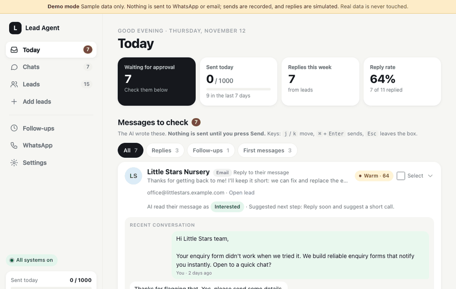

# Lead Agent v1.0.0 (draft)

*Draft for the GitHub release. Review before publishing.*

Lead Agent finds local businesses, scores them with a **local, free AI** (Ollama), drafts a personal first message, and tracks
replies and follow-ups in a phone-friendly dashboard. **Nothing is sent until you approve it.** Everything runs on your own
machine; your leads never leave it.



## Try it in one minute (no WhatsApp, no Ollama)

```bash
git clone https://github.com/MHamzaShahzad/lead-agent.git && cd lead-agent
./run.sh --demo        # http://127.0.0.1:8000, sample leads, fake sends, "Simulate reply" button
```

## Highlights

- **Find leads**: OpenStreetMap, optional Google Places, CSV import. Duplicates merge.
- **Local AI**: score, first message, replies, follow-ups, email drafts. Reply tags with a suggested next step.
- **Two WhatsApp options**: WAHA (your own number, unofficial: read the ban-risk section) or the official Cloud API. Optional email channel.
- **Safe by default**: approval before every send, sending queue with random gaps, weekday hours, daily limits, STOP handling.
- **CRM-ready**: REST API and signed webhooks (HubSpot, n8n, Zapier, Make).
- **Easy to run**: `setup.py` or the `/setup` page, Docker Compose (dashboard + WAHA + optional Ollama), demo mode.
- **Hardened webhooks**: optional `WEBHOOK_TOKEN` and WAHA HMAC-SHA512 signature check.

## Upgrading
Fresh install: follow the README. From a pre-release checkout: `git pull`, restart. The database migrates itself. To verify
WAHA webhooks add `WAHA_WEBHOOK_HMAC_KEY=<random>` to `.env` and recreate the `waha` container (`docker compose up -d --force-recreate waha`).

## Known limits
- WAHA uses an unofficial WhatsApp gateway; your number can be banned. The Cloud API is the safe route for volume.
- Small local AI models (3B) write plain drafts: always read before sending.
- Single user, single SQLite file. Not built for teams.

Full list of changes: [CHANGELOG.md](../CHANGELOG.md).

---

## Proposed good first issues (not yet created)

1. **Let drafts be written in another language**: add a language setting so the AI write drafts in a chosen language (setting + prompt tweak + test with a canned model reply).
2. **Dark-mode screenshots in the README**: capture Today, Leads and Settings in dark mode with demo mode and add them to the screenshots section.
3. **Export conversations for one lead as text/markdown**: a "Download chat" button on the lead page (`/leads/{id}/chat.txt`) with a test.
4. **Show the last backup restore steps in Settings**: a short "How to restore" help under the backup line, plus a `python -m app.restore <file>` helper with a test.
5. **Add `make`/`just` shortcuts or a `scripts/dev.sh`**: one command each for tests, demo mode and a Docker build, documented in CONTRIBUTING.
